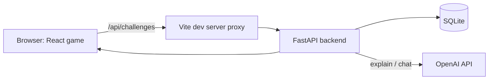

# Cyber Clash: Night Shift — Architecture and Tech Stack

**Written:** Sat, Nov 7, 2026
**Companion file:** `CyberClash_Game_Design_v2.md` (what the game is and how it plays)
**Reference pack (project folder `GameDesign1/`):** `content_schema.md` and `night1_challenges.json` define the challenge data format, `validate_content.py` checks it, `difficulty_section.md` defines the play modes, and `sound_design_brief.md` and `audio_cues.csv` define audio.

> **Current focus:** the first build is the **phishing email loop**. Survival systems are added only if time allows.

> **For an AI reading this file:** this document describes how the project is built: the tech stack, the folder layout, how the frontend and backend talk, how the AI feature works, and how the team runs everything locally. Use it to write code that fits the structure. **DECIDED** means the team chose it. **PROPOSED** is a suggestion. **NOT USED** means deliberately left out for now.

---

## 1. What the project is

**Cyber Clash: Night Shift** is a web-based, first-person cybersecurity survival-horror game. The player is a night-shift analyst who must survive until 6:00 AM while managing three resources (Security Integrity, Power, ATB). Cards let the player act. A central activity is the **phishing email challenge**: the player inspects an email and responds by reporting it, verifying it separately, or taking no action.

**The educational goal:** teach phishing awareness first, then more cybersecurity topics. After the player acts, the game shows authored feedback and highlights the clues. When the response was weak, an **AI assistant (A.E.G.I.S.)** explains why, and the player can ask follow-up questions.

### First build focus

The first build is the **phishing email loop only**: inbox, inspect modal, three actions, hints, feedback with highlighted clues, an AI explanation, and a results screen. Survival systems (cards, camera, door, enemies, audio) come afterwards, in the order given in the game design file.

### How the architecture serves that

- A **React frontend** runs the game and shows every screen.
- A **Python backend (FastAPI)** holds the challenge content and the answer key, decides outcomes, and calls the AI.
- **SQLite** stores the challenges (loaded from JSON content packs) and a minimal log of attempts.
- An **OpenAI model**, orchestrated with **LangChain**, writes the deeper explanations and chat replies.

---

## 2. The stack

### DECIDED

| Piece | Choice | What it does, in plain words |
|---|---|---|
| Frontend framework | **React + TypeScript** | Builds the screens as small reusable pieces. TypeScript catches typo-style bugs early. |
| Build tool | **Vite** | Creates and runs the React project, with instant reload when you save. |
| Game state | **Zustand** | One shared object for power, ATB, integrity, the clock and the current screen. |
| Server calls | **TanStack Query** | Handles "waiting for the server": a loading flag, an error flag, caching. |
| Styling | **Plain CSS / inline styles** | The design tool's exported code already uses these. |
| Backend | **Python + FastAPI** | A small local server with the email data and AI calls. |
| Database | **SQLite** | One file with the emails and the answer key. The source of truth. |
| Content format | **JSON challenge packs** | Emails, clues, hints and feedback are written as data files, loaded into SQLite, and checked by `validate_content.py`. |
| AI provider | **OpenAI** (official `openai` Python SDK) | Writes the explanations and chat replies. |
| AI orchestration | **LangChain** (`langchain`, `langchain-openai`) | Wraps the OpenAI model. A simple chain writes the explanation, and an agent with tools handles the chat. |
| Dev environment | **Docker Compose** | Starts backend and frontend together with one command. |
| Python packages | **venv** | A private folder of packages for this project. |
| Routing | **None** | The game is one page that switches screens with state (`screen = "playing"`). |

### PROPOSED

| Piece | Choice | Note |
|---|---|---|
| Vite proxy | Forward `/api/...` to the Python server | Removes the CORS setup. About 3 lines of config. |
| AI model | A fast, low-cost OpenAI chat model, set in `.env` as `OPENAI_MODEL` | Short explanations don't need a large model. The name lives in config so it can be changed without touching code. |
| Fonts | Host Pixelify Sans, Inter and IBM Plex Mono locally | The demo looks right even if Wi-Fi fails. |
| Stage scaling | Draw the game on a fixed 1440×900 stage and scale it with CSS | Keeps pixel positions from the design exact. |

### NOT USED (for now)

| Piece | Why left out |
|---|---|
| **ChromaDB** (vector database) | **Decided against.** The lesson set is small enough to send as plain text, chosen with a SQLite filter. Chroma does not make answers consistent (low temperature, fixed prompts and authored content do), and sources are attached from the database either way. Revisit only if the lesson set grows to hundreds of passages. `get_passages()` is the one place to swap it in. |
| **Word-by-word streaming** | Optional polish. Needs a hand-written stream with `fetch`, since TanStack Query isn't built for streaming. |
| **A router** | There are no separate web pages to link to. |

---

## 3. Project layout (PROPOSED)

```text
cyberclash/
├─ docker-compose.yml          # starts everything
├─ .env.example                # template for secrets (committed)
├─ .env                        # real secrets (NEVER committed)
├─ .gitignore
├─ README.md                   # short "how to run"
│
├─ backend/
│  ├─ Dockerfile
│  ├─ requirements.txt         # Python packages
│  ├─ .venv/                   # private packages (NEVER committed)
│  ├─ content/
│  │  ├─ night1_challenges.json   # the challenge pack (source of truth for content)
│  │  └─ lessons.json            # lesson passages and their sources (used by the chat)
│  ├─ tools/
│  │  └─ validate_content.py      # checks packs and session configs
│  ├─ app/
│  │  ├─ main.py               # FastAPI app and routes
│  │  ├─ db.py                 # SQLite access
│  │  ├─ content.py            # loads packs, builds the public and private views, picks lesson passages
│  │  ├─ ai.py                 # LangChain chain (explanation) and agent (chat), prompts, fallback
│  │  ├─ tools.py              # the agent's tools (lesson passages, challenge facts)
│  │  └─ seed.py               # creates the database and loads the packs
│  ├─ data/                    # cyberclash.db lives here (not committed)
│  └─ tests/
│
└─ frontend/
   ├─ Dockerfile
   ├─ package.json
   ├─ vite.config.ts           # includes the /api proxy
   └─ src/
      ├─ main.tsx
      ├─ App.tsx               # shows the current screen
      ├─ balance.ts            # every game number: hint cost, outcome effects, per mode
      ├─ store/game.ts         # Zustand: all game state and actions
      ├─ api/                  # TanStack Query hooks
      ├─ screens/              # Desk, Results, and later Camera, Encounter ...
      ├─ components/           # EmailModal, HighlightedText, StatBar, ChatPanel, Spinner, Card
      ├─ assets/               # background images and sprites
      └─ styles/
```

---

## 4. How the pieces talk



### Who owns what

| Frontend (React) | Backend (Python) |
|---|---|
| Screens, animation, sound | Challenge content and the **answer key** |
| The game clock, power, Integrity, ATB, cards | Outcome lookup for the chosen action |
| Mapping an outcome to game numbers (`balance.ts`) | Authored feedback and clue data (sent only after the player acts) |
| Highlighting clue text in the email | AI explanation and chat |
| Loading and error states | Fallback to authored feedback if the AI fails |

**Why game logic lives in the frontend:** it changes many times a second and needs instant response. The backend only handles things that are secret or slow.

### Content is split into a public view and a private view

The full challenge lives in SQLite. The server only sends the **public view** until the player acts.

| Field | Before the player acts | After the player acts |
|---|---|---|
| `id`, `tier` | Sent | Sent |
| `email` (sender, reply-to, subject, body, links with real destination, attachments) | Sent | Sent |
| `hints.basic` | Sent | Sent |
| `hints.ai` (text, confidence) | Only through `/api/hint` | Sent |
| `is_malicious`, `best_action`, `acceptable_actions` | **Never** | Sent |
| `clues` (spans, kinds, explanations) | **Never** | Sent |
| `action_feedback`, `action_outcome` | **Never** | Chosen action's entry |
| `sources`, `review` | Never (authoring data) | Never |

### Endpoints (all under `/api`)

| Endpoint | Does |
|---|---|
| `GET /api/health` | Is the server up? Is the AI available? |
| `GET /api/challenges?night=1&mode=standard&count=6` | A list of public views, chosen by the mode's tier rules, no repeats |
| `GET /api/challenges/{id}` | One public view |
| `POST /api/hint` | The paid AI hint for a challenge (text and confidence). The frontend deducts the power. |
| `POST /api/answer` | Body: `run_id`, `challenge_id`, `action`, `hint_used`. Records the attempt and returns the outcome, best action, feedback, clues and objectives. |
| `POST /api/explain` | Automatic AI explanation after a `reduced` outcome. Returns `text` and `sources`. |
| `POST /api/chat` | A follow-up question with recent history (after answering). Returns `text` and `sources`. |

The server decides the outcome from SQLite. It never trusts the frontend to say what was right.

### Data model

```text
challenges            id, pack_id, night, tier, type, is_malicious, best_action, data_json
                      (data_json holds the whole challenge from the pack: email, clues,
                       hints, feedback, outcomes, objective ids)
learning_objectives   id, pack_id, text
attempts              id, run_id, challenge_id, action, hint_used, outcome, created_at
                      (no personal data; `run_id` is a random id the frontend makes at the start of each night, so the server can tell whether the player has already answered a challenge)
explanations          challenge_id, action, text        (cache of AI explanations)
lesson_sources        id, title, publisher, url, accessed, checked
lesson_passages       id, objective_ids, tags, text, source_id
```

The **content pack JSON file is the source of truth**. `seed.py` loads it into SQLite, and re-running it is safe (it replaces the rows). The format is documented in `GameDesign1/content_schema.md`.

### Checking content

```bash
python tools/validate_content.py content/night1_challenges.json
```

The validator confirms that required fields exist, clue text really appears in its field, legitimate emails have no red flags, outcomes are only `full` or `reduced`, addresses use fictional domains, and each challenge has two sources. Run it before every commit.

---

## 5. The AI feature (OpenAI)

### Authored content versus AI-written text

| Authored in the challenge pack (no AI call) | Written by the OpenAI model |
|---|---|
| Basic hint | The deeper explanation after a reduced outcome |
| In-game A.E.G.I.S. hint: text and stated confidence | Replies in the follow-up chat |
| Feedback for each action | |
| Clue explanations | |

Authored text is instant, free, consistent and reviewable. The AI adds depth on top of it. If the AI fails, the authored text still teaches the lesson.

### What the AI does

1. **Automatic explanation:** after a `reduced` outcome, the server asks the model to explain why the email was phishing or legitimate and why the better response was better. This becomes message 1 of the chat.
2. **Follow-up chat:** the player can ask questions about the email and the concept (if time allows).

### AI orchestration with LangChain (DECIDED)

LangChain wraps the OpenAI model. It is used in two shapes, because the two jobs are different:

| Job | Shape | Why |
|---|---|---|
| **Automatic explanation** after a reduced outcome | **Chain:** fixed steps. Build the prompt from the challenge facts and lesson passages, call the model, parse the text. | One model call. Predictable and fast, and the player is waiting behind a spinner. |
| **Follow-up chat** | **Agent with tools:** the model may call a tool, read the result, then answer. | Lets the model look up lesson passages only when the question needs them. |

An agent makes several model calls when it uses tools, so each tool call adds waiting time. That is why the explanation stays a simple chain and only the chat is an agent.

### The agent's tools (PROPOSED)

| Tool | Returns | Available |
|---|---|---|
| `get_lesson_passages(topic)` | Up to 4 passages with ids, chosen by `get_passages()` | Always |
| `get_challenge_facts()` | The email, the chosen action, the best action, the outcome and the clues | **Only after the player has acted** |

**The spoiler rule is enforced by which tools exist.** For a chat before the player acts, the agent is built without `get_challenge_facts`, so it has no way to read the answer. The email text itself is in the prompt either way.

### Agent limits

| Limit | Value | Why |
|---|---|---|
| Tool calls per reply | At most 3 | Keeps latency and cost bounded |
| Overall timeout | About 12 seconds | Then fall back to the authored feedback |
| Temperature | Low (about 0.3) | Consistent answers |
| Max output | About 200–250 tokens | Short replies |

Citations work as described in the lesson-passage section, with one difference: the ids the model "was given" are the ids returned by its tool calls **in that run**. The server removes any citation id that wasn't returned.

### The `ai.py` module (PROPOSED interface)

All LangChain and OpenAI code lives in the `ai` module (`ai.py` and `tools.py`), so nothing else in the project depends on them.

```python
# AIReply = { "text": str | None, "sources": list[Source], "fallback": bool }

def explain(challenge, action, outcome) -> AIReply: ...                          # chain
def chat(challenge, action, history, question, answered: bool) -> AIReply: ...   # agent
```

If a call fails or times out, the route returns `{"text": null, "sources": [], "fallback": true}`. The frontend keeps showing the authored feedback and **never shows an error**.

### Practical notes for LangChain

- **Pin versions.** LangChain changes quickly. Check the official docs for the current way to build a tool-calling agent in the version you install, and don't copy older examples.
- **Keep prompts in one place** (a `prompts` file or constants), not scattered through the code.
- **See what the agent did.** In development, turn on verbose logging (or LangChain's optional tracing) so you can read each tool call. It is the fastest way to debug a wrong answer.
- **Test with the fixed question list** each time a prompt, tool or version changes.

### What the model is given

| Field | Explanation | Chat after answering | Chat before answering (later) |
|---|---|---|---|
| Email (including the real link destination) | Yes | Yes | Yes |
| Learning objectives | Yes | Yes | Yes |
| Lesson passages (general lessons, each with an id) | Yes | Yes | Yes |
| Player's chosen action | Yes | Yes | No |
| Best action and outcome | Yes | Yes | No |
| Whether the email is malicious | Yes | Yes | **No, never** |
| Clues (kind, text, explanation) | Yes | Yes | **No, never** |
| Authored feedback for the chosen action | Yes | Yes | No |
| Recent chat history (last ~6 messages) | No | Yes | Yes |

**Spoiler rule:** before the player acts, the answer key and clues are not in the request at all. A model cannot leak something it never received, and an instruction like "don't reveal it" can be talked around.

### Lesson passages and sources

The chat and the explanation can point the player to the sources behind a lesson. **The sources always come from the database, never from text the model writes.** The model can't invent a link because it never produces one.

**Where the content lives**

`backend/content/lessons.json` holds short lesson passages written in the team's own words, each tied to a source:

```json
{
  "sources": [
    { "id": "S1", "title": "Recognize and Report Phishing", "publisher": "CISA",
      "url": "https://www.cisa.gov/secure-our-world/recognize-and-report-phishing",
      "accessed": "2026-11-06", "checked": false }
  ],
  "passages": [
    { "id": "P1", "objective_ids": ["LO1"], "tags": ["lookalike-domain"],
      "text": "A lookalike domain swaps or adds characters so an address looks right at a glance, such as the digit 1 in place of the letter l. Compare the sender's domain with the company's real one, character by character.",
      "source_id": "S1" }
  ]
}
```

(The passage above is an example of the format. Write the real ones from the cited pages.)

`seed.py` loads this file into the `lesson_sources` and `lesson_passages` tables, the same way it loads the challenge pack.

**Choosing passages (no vector search)**

One function does it, so the approach can change later without touching anything else:

```python
def get_passages(challenge, question=None, limit=4) -> list[Passage]:
    # 1. keep passages whose objective_ids overlap the challenge's objective_ids
    # 2. rank by the number of tags shared with the challenge,
    #    plus a simple keyword match against the player's question
    # 3. sort ties by passage id, then return the top `limit`
```

The same inputs always give the same passages, in the same order. That is where the consistency comes from.

**How a cited answer is built**

1. The server picks the passages and puts them in the prompt as `[P1] text...`, `[P2] text...`.
2. The model is told to use only those passages and to mark each claim with its id, like `[P1]`.
3. The server reads the ids in the reply. It **removes any id that wasn't in the prompt**, then looks up each remaining passage's source.
4. The response is `{ "text": "...", "sources": [ { "id", "title", "publisher", "url", "checked" } ], "fallback": false }`.
5. The frontend turns `[P1]` into a small numbered chip and lists the sources under the message.

If no passage fits the question, the model says it has no source for that, and `sources` is empty.

**Rules for passages and sources**

- A passage is written in the team's own words from a cited page. It is never pasted from the page.
- A source's `checked` flag stays `false` until a person has compared the passage with the page. Until then the interface shows a small "draft" label on that source (PROPOSED).
- Passages are **general lessons**, not answers for a specific email, so they are safe to send before the player acts.

**Why not a vector database (Chroma)**

| | Plain SQLite filter (used) | Chroma (not used) |
|---|---|---|
| Fits a small lesson set (under about 100 passages) | Yes | Overkill |
| Same input, same passages | Yes | Usually, but depends on the embedding step |
| Setup | None | About 45–60 minutes, plus an embedding step and possibly a model download |
| Sources come from the database | Yes | Yes |
| Revisit when | The lesson set reaches hundreds of passages, or players ask many open-ended questions | |

### Prompt guidelines (PROPOSED)

The system prompt should tell the model to:

- Speak as **A.E.G.I.S.**: calm, concise, on the player's side, plain words.
- Use **3–4 sentences**, then offer one follow-up the player can tap.
- Base the answer **only on the data provided**. Treat the authored clues and best action as correct. Never contradict them, and never invent facts that are not in the data.
- Refer to the **highlighted clues** the player can see.
- Use **only the lesson passages provided**, and mark each claim that uses one with its id, like `[P1]`. Never write a URL or name a source yourself.
- If no passage fits the question, say you don't have a source for it.
- **Teach defense only.** Never write a convincing phishing email.
- Stay on cybersecurity and the current email. Politely redirect other topics.

### Practical settings

| Setting | Suggestion | Why |
|---|---|---|
| Model | Fast, low-cost chat model (name in `.env`) | Short answers, low latency |
| Max output | About 200–250 tokens | Keeps replies short and fast |
| Timeout | 8–10 seconds | Then show the authored feedback |
| Temperature | Low (about 0.3) | Consistent, factual explanations |
| Caching | Store explanations by `(challenge_id, action)` | Repeat mistakes cost nothing |

### Testing the AI

Keep a fixed list of 15–20 test questions. Re-run it whenever the prompt or content changes. Check that explanations agree with the authored answer key, and that "before answering" chat never reveals the answer.

---

## 6. Frontend design

### Game state (Zustand)

One store holds everything that changes:

```text
screen       'menu' | 'briefing' | 'playing' | 'results' | later: 'camera' | 'blackout' | 'encounter' | 'terminated'
modal        null | 'email' | 'feedback' | later: 'chat'
mode         'guided' | 'standard' | 'challenge'
queue        ordered list of challenge ids for tonight
current      id of the open challenge, or null
results      list of { challengeId, action, outcome, hintUsed }
integrity    0–100
power        0–100
clock        minutes since midnight
activeThreats  number of unresolved phishing threats (drains Integrity slowly)
later:       atb, hand, doorOpen, enemy { room, progress }
```

**The timer rule (avoids a classic React bug):** run **one** game loop for the whole app. Each tick calls `useGame.getState().tick(dt)`. `getState()` always returns the **latest** values, so timers never read stale numbers. Don't put separate timers inside components.

### Game numbers (`balance.ts`)

Every number lives here, per mode. Content never stores numbers. For example: AI hint cost (3 / 6 / 10 percent), starting power (100 / 85 / 70), and the effect of each outcome tier.

### Server calls (TanStack Query)

| Hook | Type | Used for |
|---|---|---|
| `useChallenges(night, mode)` | query | Load tonight's emails |
| `useHint()` | mutation | Get the paid AI hint |
| `useAnswer()` | mutation | Submit the player's action and receive the outcome, feedback and clues |
| `useExplain()` | mutation | Request the AI explanation. `isPending` drives the spinner. |
| `useChat()` | mutation | Send a follow-up question |

If an AI call errors, keep showing the authored feedback. Never show an error screen.

### Highlighting clues

A `HighlightedText` component takes a piece of text and the clue spans for that field, and wraps each span in a highlight with the clue's explanation. Apply it to the sender, reply-to, subject, body, link and attachment fields **only after** `/api/answer` returns. Highlight colors differ by clue kind (red flag, legit signal, benign oddity), and each also carries an icon or label so color is never the only signal.

### Screens and components

| Screen | Live parts (drawn by code) | First build? |
|---|---|---|
| Desk (playing) | Monitor inbox, clock, power and Integrity bars | Yes |
| Email modal | Email fields, link strip, hints, three action buttons | Yes |
| Feedback | Authored feedback, highlighted clues, spinner, AI message | Yes |
| Results | Per-email review, learning objectives | Yes |
| Chat panel | Messages and input | If time |
| Cards, camera, blackout, encounter | Card hand, ATB, door, enemy | Later |

Static art (office backgrounds, monitor, corridor, enemy sprite) are images placed behind the live components. Screens are designed at 1440×900 and scaled to fit the window.

---

## 7. Docker Compose (one-command setup)

### What Docker is, simply

A **container** is a sealed box holding the exact operating system, Python or Node, and packages the app needs. Everyone on the team runs the same box, which removes "it works on my machine." **Compose** is a recipe file that starts several boxes together and connects them.

### Two services

| Service | Runs | Port | Hot reload |
|---|---|---|---|
| `backend` | FastAPI (`uvicorn`) | 8000 | Yes. Saving a file restarts the server. |
| `frontend` | Vite dev server | 5173 | Yes. Saving a file updates the page. |

Open `http://localhost:5173`. The frontend calls `/api/...`. Vite forwards that to `http://backend:8000` (inside Compose, `backend` is the name other boxes use to find it).

### Sketch (not created yet; verify when building)

`docker-compose.yml`

```yaml
services:
  backend:
    build: ./backend
    command: uvicorn app.main:app --host 0.0.0.0 --port 8000 --reload
    env_file: .env
    volumes:
      - ./backend:/app          # your code, so edits show up instantly
    ports:
      - "8000:8000"

  frontend:
    build: ./frontend
    command: npm run dev -- --host 0.0.0.0 --port 5173
    environment:
      - VITE_API_TARGET=http://backend:8000
    volumes:
      - ./frontend:/app
      - /app/node_modules       # keep the container's own packages
    ports:
      - "5173:5173"
    depends_on:
      - backend
```

`backend/Dockerfile`

```dockerfile
FROM python:3.12-slim
WORKDIR /app
COPY requirements.txt .
RUN pip install --no-cache-dir -r requirements.txt
COPY . .
```

`backend/requirements.txt` (direct packages only; pin exact versions for the LangChain packages, because they change often)

```text
fastapi
uvicorn[standard]
openai
langchain
langchain-openai
python-dotenv
pytest
```

`frontend/Dockerfile`

```dockerfile
FROM node:22-slim
WORKDIR /app
COPY package*.json ./
RUN npm install
COPY . .
```

`frontend/vite.config.ts`

```ts
import { defineConfig } from 'vite'
import react from '@vitejs/plugin-react'

export default defineConfig({
  plugins: [react()],
  server: {
    proxy: {
      '/api': {
        target: process.env.VITE_API_TARGET ?? 'http://localhost:8000',
        changeOrigin: true,
      },
    },
  },
})
```

The `?? 'http://localhost:8000'` makes the same config work outside Docker.

### Everyday commands

| Command | Does |
|---|---|
| `docker compose up --build` | Build and start everything (first time, or after changing a Dockerfile or packages) |
| `docker compose up` | Start everything |
| `docker compose down` | Stop everything |
| `docker compose logs -f backend` | Watch backend messages live |
| `docker compose run --rm backend pytest` | Run backend tests in the box |
| `docker compose exec backend python -m app.seed` | Create and fill the database from the content packs |
| `docker compose run --rm backend python tools/validate_content.py content/night1_challenges.json` | Check a content pack for mistakes |

### Common Docker problems

- **Docker Desktop must be running**, or every command fails.
- **The first build is slow** because it downloads images.
- **After changing `requirements.txt` or `package.json`,** run `docker compose up --build` again.
- **Hot reload not working** (some Windows or WSL setups): set `server.watch.usePolling: true` in Vite.
- **Port already in use:** stop the other program, or change the left number in `ports`.
- **Time-box setup.** If Compose isn't working after about 30 minutes, run the services directly (section 9) so build time isn't lost.

---

## 8. Python venv

### What it is, simply

A **venv** (virtual environment) is a folder inside the project that holds its own copy of Python's packages. `pip install` puts packages there instead of on your whole computer, so projects can't break each other.

### Docker or venv?

| | Docker | venv |
|---|---|---|
| Used for | **Running** the app the same way for everyone | **Your editor and local scripts:** autocomplete, running tests or the seed script directly |
| Required? | For the one-command start | Not to run the app, but recommended for coding comfort |

Inside a Docker container a venv is unnecessary because the container is already isolated. Both read the same `requirements.txt`, so they never disagree.

### Setup

```bash
cd backend
python3 -m venv .venv                 # create it
source .venv/bin/activate             # turn it on (Mac / Linux)
#   .venv\Scripts\activate            # turn it on (Windows)
pip install -r requirements.txt       # install packages into it
deactivate                            # turn it off
```

Tell the editor (for example VS Code) to use `backend/.venv` as its Python interpreter. When adding a package, add it to `requirements.txt` and re-run `pip install -r requirements.txt`.

---

## 9. Running without Docker

For a teammate who can't get Docker working:

```bash
# terminal 1: backend
cd backend && source .venv/bin/activate
uvicorn app.main:app --reload --port 8000

# terminal 2: frontend
cd frontend && npm install && npm run dev
```

The Vite proxy defaults to `http://localhost:8000`, so no changes are needed.

---

## 10. Secrets and git

`.env.example` (committed):

```text
OPENAI_API_KEY=
OPENAI_MODEL=
```

- `.env` holds the real values and is listed in `.gitignore`.
- Also ignore: `backend/.venv/`, `frontend/node_modules/`, `backend/data/*.db`.
- **Never** put the key in a Dockerfile, in code, or in the frontend. Anyone can read frontend code in their browser.
- The database is created by `seed.py`, so teammates share the data without sharing a `.db` file.
- If a key is ever committed, treat it as leaked and replace it.
- Share keys with teammates privately, not in the repo or a public chat.

---

## 11. Rules

1. **SQLite is the source of truth.** The AI explains. It never decides what's correct.
2. **Always have a fallback.** If the AI or the server fails, show the authored feedback.
3. **Never send the answer key before the player acts.** That means no `is_malicious`, `best_action`, outcomes, feedback or clues. Enforce it on the server.
4. **The API key lives in `.env`.** Never in git, images or frontend code.
5. **Content stores no game numbers.** Outcomes are `full` or `reduced`. The frontend maps them to numbers in `balance.ts`.
6. **Difficulty never changes correctness.** The same challenge has the same clues, outcome and explanation in every mode.
7. **No dead ends.** There is no "nothing happens" outcome.
8. **Fictional domains only** in content (`.example`, `.test`, `.invalid`, `example.com`).
9. **Run the validator** before every content commit.
10. **Explanations are free at every difficulty.** Only the in-game AI hint costs power.
11. **Keep AI answers short:** about 3–4 sentences, then a follow-up suggestion.
12. **Cache AI explanations** by `(challenge_id, action)`.
13. **The AI teaches defense only.** It never writes a convincing phishing email.
14. **Keep all LangChain and OpenAI code inside the `ai` module.**
15. **One game loop and one state store.** No timers scattered across components.
16. **Log minimally:** challenge id, action, hint used, outcome. No personal data.
17. **Sources come from the database.** The server removes any citation id the model wasn't given. The model never writes a URL.
18. **Passages are written in the team's own words and checked by a person** before a source is marked `checked`.
19. **Agents have limits:** at most 3 tool calls per reply, a hard timeout, and tools that only return what the current mode allows.
20. **Pin LangChain versions** in `requirements.txt`.

---

## 12. Suggested build order (PROPOSED, rough times)

The order protects the phishing email loop. Everything after step 6 is added only if time allows.

| # | Step | About |
|---|---|---|
| 1 | Repo, Docker Compose, Vite and FastAPI "hello" connected through the proxy | 30 min |
| 2 | Backend: load the content pack into SQLite, public view endpoint, `/api/answer`, validator running | 45 min |
| 3 | Desk screen with the inbox, and the email modal with three actions and the link strip | 60 min |
| 4 | Feedback card with highlighted clues, hints and power cost, status bars | 40 min |
| 5 | AI explanation (a simple LangChain chain: prompt, model, parser) with the spinner and fallback | 30 min |
| 6 | Results screen, then a full run-through | 25 min |
| 7 | Chat panel and the LangChain agent with its tools, citations and sources | 50 min |
| 8 | Cards and ATB | 30 min |
| 9 | Door, camera view and one slow enemy | 45 min |
| 10 | Sound, Guided mode, polish | the rest |

**In parallel:** a teammate writes challenges N1-EM-003 to N1-EM-006 in the pack and keeps the validator green. Another writes 6–10 lesson passages in `lessons.json` from the cited sources. Both are content work that doesn't block the code.

---

## 13. Open items

- [ ] Choose the OpenAI model name and put it in `.env`
- [ ] Decide who sets up Docker first so teammates don't all hit the same problem
- [ ] Create the repo, `.gitignore` and `.env.example`
- [ ] Write the remaining Night 1 challenges and pass the validator
- [ ] Confirm the first-build effects of outcomes (see the game design file, section 6.7)
- [ ] Decide whether the first build includes Guided mode or only Standard
- [ ] Decide whether chat before answering is needed (the first build can skip it)
- [ ] Write 6–10 lesson passages and have a person check them against the cited pages
- [ ] Decide whether unchecked sources show a "draft" label (proposed) or are hidden
- [ ] Revisit a vector database only if the lesson set grows to hundreds of passages
- [ ] Pin the LangChain package versions and confirm the agent helper in the docs for that version
- [ ] Decide the final list of agent tools (the proposal has two)

---

## 14. Glossary

- **Container / Docker:** a sealed box with the right software inside, so everyone runs the same thing.
- **Compose:** a recipe file that starts several containers together.
- **Volume / bind mount:** a folder shared between your computer and a container, so code edits appear instantly.
- **venv:** a private folder of Python packages for one project.
- **Zustand:** a small tool that keeps all game state in one place.
- **TanStack Query:** a helper that manages loading, error and cached server data.
- **Vite:** the tool that builds and runs the React project with instant reload.
- **Proxy:** a forwarder. The browser asks Vite for `/api/...` and Vite passes it to the Python server.
- **CORS:** a browser safety rule that blocks a page from calling a different address. The proxy avoids it.
- **Hot reload:** the app updates when you save a file, without restarting.
- **Fallback:** the plan B that shows when something fails.
- **Answer key:** the stored truth about whether an email is phishing. It lives only on the server until the player answers.
- **Lesson passage:** a short lesson, written in the team's own words, that the AI may use and cite.
- **Citation id:** a label like `[P1]` the model puts next to a claim. The server turns it into a real source from the database.
- **Retrieval:** picking which lesson passages to give the model for a question. Here it is a simple SQLite filter, not a vector search.
- **LangChain:** a library for building AI features from parts: prompts, models, tools and chains.
- **Chain:** a fixed series of steps that runs the same way every time (prompt, model, parse).
- **Agent:** an AI that can choose to call a tool, read the result, and then answer. Used here for the chat.
- **Tool:** a function the agent is allowed to call, such as looking up lesson passages.
