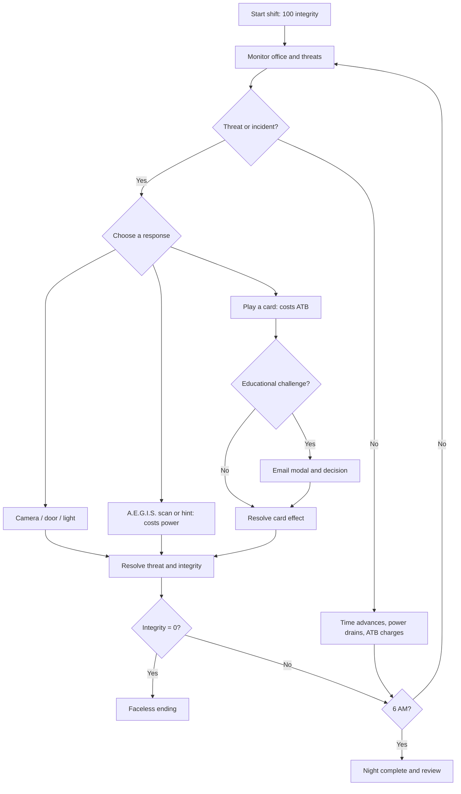
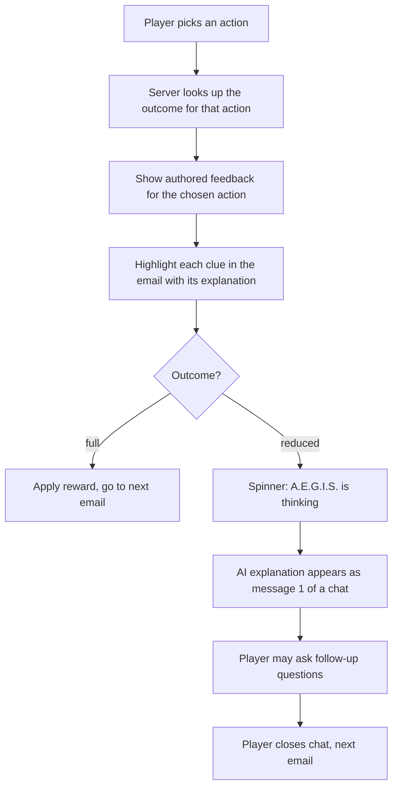

# Cyber Clash: Night Shift — Game Design

**Project type:** Hackathon game (web-based, single-player)
**Genre:** First-person cybersecurity survival horror with a card and real-time resource system
**Written:** Sat, Nov 7, 2026
**Companion file:** `CyberClash_Architecture_v2.md` (tech stack, project layout, backend, Docker)
**Reference pack (project folder `GameDesign1/`):** `difficulty_section.md` (play modes), `content_schema.md` (how challenges are stored), `night1_challenges.json` (example challenges), `session_config.example.json`, `sound_design_brief.md` and `audio_cues.csv` (audio), `validate_content.py` (content checker). This file summarizes what those decide.

> **Current focus:** the first build is the **phishing email loop**: reading an email, choosing a response, and learning from the result. Survival systems (cards, camera, door, enemies, audio) are added only if time allows. Section 11 gives the order.

> **For an AI reading this file:** this document explains what the game is, why it exists, how it plays, and what is in scope for the first build. Use it to help the team write code, content, copy and tests that match the design. When something is marked **PROPOSED**, it is a suggestion the team has not confirmed. **DECIDED** means the team chose it.

---

## 1. Purpose and goals

### Why this game exists

Cyber Clash teaches **cybersecurity awareness, starting with phishing**, by putting the player in a tense, atmospheric situation where good security decisions keep them alive. The learning is part of the survival loop, not a quiz bolted onto a game. It is meant for students and new employees who need practice recognizing suspicious messages and understanding *why* something is a threat.

### The three ideas the game must get across

1. **Survival pressure.** The player must reach 6:00 AM. Power, ATB (card energy) and Security Integrity (health) push back, and every choice costs something.
2. **Decide with evidence.** An email modal makes the player inspect the sender, link and wording and decide: phishing or legitimate.
3. **Learn from mistakes.** When the player is wrong, an AI assistant explains *why*, and the player can ask follow-up questions. The assistant is also something the player should not blindly trust.

If a feature serves none of these, cut it.

### Design pillars

1. **Horror and tension:** limited visibility, unpredictable encounters, an unsettling office.
2. **Meaningful resource decisions:** power runs cameras, door, lights and AI help. ATB pays for cards.
3. **Threatened security:** Security Integrity tracks how protected the player is. At 0, a faceless figure claims them in an ambiguous, non-graphic ending.
4. **Cybersecurity through play:** cards and email scenarios teach phishing, MFA, firewalls and incident reporting.
5. **Fair learning:** mistakes produce useful feedback. Early levels teach before they pressure.
6. **Replayability:** varied emails, enemy routes and events.

> Power outages, monsters and the AI character are gameplay metaphors. They are not literal descriptions of how security systems work.

---

## 2. Story and setting

The player is a **night-shift cybersecurity analyst** alone in a corporate office after hours. A mysterious security incident is underway. **Faceless figures** appear on surveillance cameras, systems misbehave, and suspicious emails keep arriving.

The player watches **cameras**, controls a **door**, and plays **cybersecurity cards**. An in-game AI assistant, **A.E.G.I.S.**, offers hints and scans, but each use drains **power**, and A.E.G.I.S. can be wrong.

The ending at zero Security Integrity is **deliberately ambiguous and non-graphic**. The end screen reads **"SHIFT TERMINATED — EMPLOYEE STATUS: UNKNOWN"**. It never confirms death.

The enemies are metaphors for threats, not for coworkers. The briefing screen says so and includes a short content note that the game has mild horror themes and a low-intensity setting.

---

## 3. The three resources

| Resource | What it means | At zero |
|---|---|---|
| **Security Integrity** (health, 0–100) | How protected the player is. It is a fictional measure, not physical health. | The faceless ending starts. Game over. |
| **Power** (0–100%) | Runs cameras, door, lights and AI help. Drains slowly, plus extra for active systems. | **Blackout.** Cameras, AI and powered defenses fail and breaches become much likelier. It is not instant death. |
| **ATB** (0–10) | Card energy. Charges over time and through good decisions. | Cards can't be played until it refills. |

### Security Integrity bands

| Range | Label | Feel |
|---|---|---|
| 100–71 | **SECURE** (green) | Defenses reliable, enemies can still approach |
| 70–41 | **EXPOSED** (yellow) | Glitches and warnings, more threatening audio |
| 40–1 | **BREACHED** (red) | Heavy interference, faceless proximity |
| 0 | **COMPROMISED** | Faceless encounter, then game over |

### Example integrity changes (starting values, to be playtested)

| Event | Effect |
|---|---|
| Correctly identify and report phishing | Prevents the related loss |
| Leave a phishing threat active (a weak response) | Slow drain until the threat is handled (PROPOSED) |
| Enemy breaches a poorly defended corridor | −20 |
| Faceless figure reaches the workstation | −40 (unless countered) |
| Successful incident-response card | +15 (max 100) |
| Effective Firewall card | Shields the next qualifying breach |

Integrity changes must have clear, visible causes. A poor judgment call does **not** subtract Integrity directly. It lowers the outcome (a weaker effect) and can leave a threat active. Integrity is lost when threats actually reach the player.

**Power and integrity are separate.** A player at 100 integrity and 0% power can still survive for a while using manual actions. A player at 0 integrity loses even with full power.

---

## 4. Core loop

> This is the full game loop. The first build runs only the email part of it (section 11).

1. **Observe:** cameras, audio cues, alerts, suspicious messages.
2. **Decide:** manual action, AI help (power), or a card (ATB).
3. **Learn:** if a card opens a challenge, inspect the evidence and decide.
4. **Resolve:** update integrity, power, ATB, enemy behavior and time.
5. **Survive:** repeat until 6:00 AM.

**Fairness rule:** when the email modal or chat is open, enemies pause or slow down. The challenge should test reasoning, not reading speed.

---

## 5. Cards

> **First build:** cards are not required. The player opens emails straight from the inbox. Cards and ATB come in the next stage (section 11).

| Category | Cards | Purpose |
|---|---|---|
| **Analyze** | Phishing Analysis, Log Review | Examine evidence. Phishing Analysis opens the email modal. |
| **Defend** | Firewall, MFA, Encryption | Reduce or block incoming damage |
| **Recover** | Quarantine, Patch, Backup | Contain or repair |

**First build hand (DECIDED, 3 cards):**

| Card | Tag | Cost | Effect |
|---|---|---|---|
| Phishing Analysis | ANALYZE | 2 ATB | Open an email. Decide phishing or legit. |
| Firewall | DEFEND | 3 ATB | Shield the next breach |
| Quarantine | RECOVER | 2 ATB | Isolate a suspect system |

Cards are spent with ATB. A card's cost is deducted exactly once. If the player can't afford a card, it shows as unavailable.

---

## 6. The email challenge and the learning system (core of the first build)

### 6.1 What the player sees

The in-game monitor shows a mail inbox with six messages (three unread). Opening one shows the **inspect modal**:

- Sender name and address, and a reply-to address if it differs
- Time, subject and body
- Any attachments
- A yellow **LINK GOES TO** strip showing where each link *really* goes. The link text can say one thing while the real address is another.

### 6.2 Three possible actions

| Action | Meaning |
|---|---|
| **Report** | Flag the message to the security team |
| **Verify separately** | Contact the sender through a channel you already know (a known phone number or the intranet), never through the email itself |
| **No action** | Leave it alone |

Every challenge defines a **best action**, a list of **acceptable actions**, and an **outcome** for each action: `full` or `reduced`. There is no "nothing happens" outcome, so a wrong choice is never a dead end.

Typical pattern:

| Email is... | Report | Verify separately | No action |
|---|---|---|---|
| Phishing | **full (best)** | full | reduced |
| Legitimate | reduced (false alarm) | full | **full (best)** |

### 6.3 Hints

| Hint | Cost | What it gives |
|---|---|---|
| **Basic** | Free | A nudge toward the evidence, never the answer ("Look at the sender's domain") |
| **AI (A.E.G.I.S.)** | Power (6% on Standard) | Pre-written text with a stated confidence, such as "about 70% sure" |

The AI hint is **authored with the challenge**, and each one is marked correct or not. In Night 1 every AI hint is correct, so players learn it is worth using. In Night 4 some are wrong, so players learn to verify. **Night 1 must be solvable with no hint at all.**

### 6.4 After the player acts

- **Authored feedback and highlights appear instantly**, with no AI call. The AI explanation arrives a moment later and goes deeper.
- **Explanations are free at every difficulty** and are never hidden.
- **If the AI fails**, the authored feedback stays on screen. The player never sees an error.
- The **content stores no game numbers**. It says `full` or `reduced`, and the game maps that to Integrity, ATB and power values in one balance table.

### 6.5 Clue highlights

Each challenge lists clues. A clue points at an exact piece of text in one field (sender, reply-to, subject, body, link or attachment), says what kind of clue it is, and explains why it matters.

| Kind | Meaning |
|---|---|
| `red_flag` | Evidence of phishing |
| `legit_signal` | Evidence the message is genuine |
| `benign_oddity` | Looks suspicious but is fine (for example, a time-sensitive notice that only gives information) |

A phishing email must have at least one red flag. A legitimate one has no red flags and at least one legit signal. Highlights appear **only after** the player acts.

### 6.6 Content difficulty (tiers)

Each challenge has a `tier` from 1 to 3, set by its author. Tier is separate from the play mode. The mode only decides which tiers can be drawn.

| Tier | Phishing emails | Legitimate emails |
|---|---|---|
| 1 | Several independent tells (3 or more red flags) | Clearly benign |
| 2 | One or two clean tells, such as a lookalike domain or a link mismatch | Benign, with one detail worth checking |
| 3 | Subtle: 2 or fewer red flags, or one easily missed tell | Benign but unusual, with at least one `benign_oddity` |

Night 1 uses tiers 1 and 2.

### 6.7 Consequences in the first build (PROPOSED)

Without enemies in the first build, outcomes need a simple effect. All numbers live in one balance file and are tuned in playtesting.

| Outcome | Effect |
|---|---|
| Full, phishing email | Threat neutralized. Small Integrity recovery (for example +5, max 100). |
| Full, legitimate email | No effect. It was correctly left alone or checked. |
| Reduced, phishing email | Threat stays active and slowly drains Integrity until the night ends. |
| Reduced, legitimate email | False alarm: a small power cost (time wasted). |

### 6.8 AI chat and the spoiler rule

After a reduced outcome, the AI explanation becomes message 1 of a chat, so follow-up questions already have context.

| | Before answering | After answering |
|---|---|---|
| Goal | Teach the concept without revealing the answer | Discuss this email freely |
| AI is given | Email and learning objectives only | Email, answer, clues, feedback, learning objectives |

**Spoiler rule:** before the player acts, the answer key (best action, clues, feedback, whether the email is malicious) is **never sent to the AI**, and never sent to the browser either. The server enforces this.

**Sources:** explanations and chat replies show the sources behind them. The server picks short lesson passages and attaches their sources from the database, so the AI cannot invent a source. A source shows a small "draft" label until a person has checked it.

**First build (PROPOSED):** after-answer chat only, and only if time allows. The automatic explanation comes first.

### 6.9 The AI persona: A.E.G.I.S.

The same character appears in the game world (hints) and in the explanation and chat. It should be:

- Calm, concise, slightly clinical, and on the player's side
- Honest about uncertainty ("I'm about 70% sure")
- Plain-spoken: 3–4 sentences, then one follow-up offer
- A teacher of defense only. It never writes a convincing phishing email.
- Occasionally wrong **in the in-game hint** on later nights. The explanation after an answer is always based on the stored answer key and must be correct.

---

## 7. Enemies

> **Not in the first build.** Listed here so the design stays complete.

| Enemy | Night | Behavior | Counterplay | Lesson |
|---|---|---|---|---|
| **Faceless Figure** | 1 | Walks a monitored corridor toward the cubicle. Damages integrity if it arrives. | Watch cameras, close the door, manage power | Observe and verify |
| Watcher | 2 | Exploits gaps in camera coverage | Rotate checks, respond to sound | Monitoring has limits |
| Technician | 3 | Disrupts cameras and controls | Contain sabotage | Resilience and access control |
| Mimic | 4 | Sends deceptive messages | Verify identities | Social engineering |
| The Intelligence | 5 | Combines deception and physical threats | Layered defense | Incident response |

Every enemy needs a readable warning cue and at least one fair response. No unavoidable random deaths.

---

## 8. Campaign, play modes and difficulty

### Principles

1. **One game, three entry modes** (Guided, Standard, Challenge), not three versions of the game.
2. **Two separate dials.** *Survival pressure* is set by the mode. *Content difficulty* is set by the night and the challenge tier. Changing the mode never changes what is taught or whether an answer is correct.
3. **Learning never depends on surviving.** A player who loses the survival layer still gets the lesson.
4. **Difficulty never hides required clues or removes explanations.**
5. **Wrong choices lower the outcome, not Integrity directly.**

### Play modes

| | **Guided** | **Standard** (default) | **Challenge** |
|---|---|---|---|
| Best for | Orientation, class sessions | Free time | Replay, mastery |
| Survival preset | Story | Normal | Nightmare |
| Night length (real time) | about 6–8 min | about 10 min | about 10 min |
| Email tiers | Capped at 2 | Follows the night table | Floor of 2 |
| Hints | Free basic clue, optional AI | Optional AI | Limited AI, evidence always visible |
| While an email is open | Enemies fully paused | Enemies slowed to about 0.25x | Enemies slowed to about 0.25x |
| Availability | Always | Always | After completing any night on Standard |

The first screen asks "How do you want to play?" with **Guided** or **Standard**, in plain words with no jargon.

### Survival presets (starting values, to be playtested)

| Dial | Guided (Story) | Standard (Normal) | Challenge (Nightmare) |
|---|---|---|---|
| Enemy speed | 0.7x | 1.0x | 1.35x |
| Starting power | 100% | 85% | 70% |
| ATB gain | 1.3x | 1.0x | 0.8x |
| Minor breach damage | 10 | 20 | 30 |
| Major encounter damage | 25 | 40 | 60 |
| AI email hint cost | 3% | 6% | 10% |
| AI threat scan cost | 5% | 8% | 12% |
| Educational feedback | Full | Full | Full |

The night clock should be tuned so using the AI is sometimes the right choice and sometimes not, never always wrong.

### Five nights (roadmap)

| Night | Theme | Learning | Email tiers | AI hint accuracy |
|---|---|---|---|---|
| **1: Suspicious Activity** | Basic monitoring | Phishing clues, trusted channels, reporting | 1–2 | 100% |
| 2: Containment | Malware and access control | Malware indicators, quarantine, patching, MFA | 1–2 | 95% |
| 3: Breach | Network defense | Firewalls, suspicious traffic, escalation | 2 | 90% |
| 4: False Confidence | AI-assisted security | False positives and negatives, verifying AI advice | 2–3 | 75% |
| 5: Blackout Protocol | Incident response | Triage, layered defense, recovery | 2–3 | 85% |

### Survived versus learning complete

Track two results per night:

- **Survived:** reached 6:00 AM.
- **Learning complete:** handled every challenge assigned for the night, or reviewed the ones missed.

If the player is defeated: the ending plays (always skippable), then a review shows the challenges with clue highlights, then any unseen challenges appear in a no-pressure practice style. In Guided, the next night unlocks on *learning complete*. In Standard and Challenge, it unlocks on *survived*.

**First build:** Standard mode only, Night 1 only. Guided is next if time allows.

---

## 9. Visual identity

- **Style:** chunky, game-like UI. Thick dark outlines, hard offset shadows (no soft blur on UI), rounded corners, cream cards on a dark office.
- **Fonts:** **Pixelify Sans** for game UI. **Inter** and **IBM Plex Mono** for the in-game mail client and the email modal, so the email looks like a real mail program.
- **Key colors:** cream `#F4EFE0` (cards), dark outline `#1A2426`, panel `#374244`, blue (Cameras), yellow (Door), purple (A.E.G.I.S.), green (Secure), red (danger).
- **Mood:** a dim office with flickering light, damp stains, a distant hallway where a figure sometimes stands, and a vignette. Darker and redder when power is low or in blackout.
- **The monitor** shows a realistic mail client: sidebar, search, six messages (three unread), and a yellow tip banner reading "Review every message. Trust nothing."
- **Screen size:** all screens are designed at **1440×900** and scaled to the window.

---

## 10. Screens and game states

"First build" marks what the phishing-email-first build needs.

| State | Screen | Design status | First build? |
|---|---|---|---|
| Main menu | Menu | Not designed | No |
| Night briefing | Briefing (with the "enemies are metaphors" note) | Not designed | Optional |
| **Playing** | Desk with the monitor showing the inbox, plus status bars | Designed | **Yes** |
| **Email modal** | Inspect modal with three actions, hints and link strip | Designed (two buttons today, needs three) | **Yes** |
| **Feedback** | Authored feedback and highlighted clues (restyled wrong-answer card) | Designed, needs restyle | **Yes** |
| **Loading** | "A.E.G.I.S. is thinking..." | Not designed | **Yes** |
| **Results** | Night complete / review screen | Designed (Night Complete, Shift Terminated) | **Yes** |
| Chat panel | Conversation with A.E.G.I.S. | Not designed | If time |
| Correct answer | Short confirmation and reward | Not designed | **Yes** (can share the feedback card) |
| Card selection | Ability cards | Designed | Later |
| Camera view | Corridor feed, enemy, door, camera tabs | **Built** (CSS placeholder art, no camera-feed.png/enemy-walk.png yet) | Done |
| Blackout | Dim overlay on the dark office | **Built** | Done |
| Faceless encounter | Glitching bar, the figure | **Built** (plain CSS sprite + banner, no glitch bar or encounter head art yet) | Done |
| Cyberpedia | Definitions | Not designed | Later |

Only one modal state receives input at a time, so an email decision can't trigger the door or a card.

---

## 11. First build scope: the phishing email loop

### Core (must have)

1. An **inbox** on the in-game monitor listing the Night 1 emails, with unread markers
2. The **inspect modal** showing sender, reply-to, subject, body, attachments, and the **real destination** of each link
3. The **three actions**: Report, Verify separately, No action
4. A **free basic hint** and a **paid AI hint** (costs power; pre-written text with a confidence)
5. The **server decides the outcome** and returns feedback and clue highlights only after the player acts
6. **Highlighted clues** in the email, each with its explanation
7. An **AI explanation** (OpenAI) after a reduced outcome, with a spinner and a fallback to the authored feedback
8. A light **status bar**: night clock, power and Security Integrity, just enough to give hints a cost and outcomes a consequence
9. A **results screen**: each email, what the player chose, the best action, and which learning objectives were covered
10. A **content pack of 6 challenges** that passes the validator

**How the first build ends (PROPOSED):** the night ends when every email is handled or the clock reaches 6:00 AM. If Integrity reaches 0, show Shift Terminated, then the review.

### Next, if time allows (in this order)

1. After-answer **chat** with A.E.G.I.S.
2. **Cards and ATB**, with Phishing Analysis as the way to open the modal
3. ~~The **survival layer**: door, camera view, one slow enemy, blackout, defeat and victory screens~~ **Built**: door and camera controls, the Faceless Figure's corridor walk, a closed-door counter, breach damage, and a blackout state all live in `store/game.ts` (balance in `balance.ts`), with a CSS-placeholder camera feed (`CameraPanel.tsx`), alert banner and blackout overlay. Still open: dedicated defeat/victory screens beyond the existing Shift Terminated / Night Complete results, and the real camera-feed/enemy-walk art.
4. **Key sounds**: new-email chime, outcome tones, low-power alarm, blackout
5. **Guided mode**
6. Faceless encounter animation, dark and low-power visual variants

### Later

Nights 2–5, other enemies, deckbuilding and combos, session config and reporting, practice mode, menu polish, the full audio set.

---

## 12. Night 1 content

### Learning objectives

| ID | Objective |
|---|---|
| LO1 | Name at least three evidence-based phishing indicators |
| LO2 | Choose an appropriate response: report, verify through a separate channel, or take no action |
| LO3 | Recognize that a legitimate message can look urgent, and that one indicator alone is not proof |

### Lesson passages and sources

The chat needs 6–10 short **lesson passages**, one or two per teaching point (lookalike domains, urgency, link mismatch, unexpected requests, verifying through a trusted channel, legitimate messages that look urgent). Each is written in the team's own words from a cited page and tied to a source. They are general lessons, not answers for a specific email.

### Authoring rules

1. **Fictional only.** Every address and link uses reserved domains (`.example`, `.test`, `.invalid`, `example.com`). Use `brightfield.example` as the company. No real brands or lookalikes of real brands.
2. **30–50% legitimate** across a pack, so players learn judgment and not "suspicious-looking means phishing".
3. **Every clue explains why it matters**, not just that it exists.
4. **At least one clue the player could miss**, and at least one tempting-but-harmless detail (`benign_oddity`) where it fits.
5. **Two sources per challenge**, with each clue linked to the source that supports it.
6. **Reviewed before approval.** Status moves `draft`, then `sme_reviewed`, then `approved`. New content starts as `draft`.
7. Run the **validator** before every commit.

### Night 1 challenges (PROPOSED)

| ID | Email | Type | Tier | Status |
|---|---|---|---|---|
| N1-EM-001 | IT Helpdesk: "URGENT: Password expires in 1 hour" (lookalike domain, link mismatch, password request) | Phishing | 1 | Written (draft) |
| N1-EM-002 | Facilities Team: "Scheduled badge reader maintenance tonight" (time-sensitive but harmless) | Legitimate | 2 | Written (draft) |
| N1-EM-003 | Payroll: "Updated direct deposit form" (reply-to differs, asks for bank details) | Phishing | 2 | To write |
| N1-EM-004 | DocuShare: "You received a shared document" (expected share, link matches) | Legitimate | 2 | To write |
| N1-EM-005 | Unknown vendor: "Invoice attached, please review" (unexpected attachment) | Phishing | 1 | To write |
| N1-EM-006 | Dana, Accounting: "Lunch on Thursday?" (normal, no request) | Legitimate | 1 | To write |

That is 3 phishing and 3 legitimate. Content packs are JSON files. The format is explained in `GameDesign1/content_schema.md`, with a worked example in `GameDesign1/night1_challenges.json`.

**The two written challenges are drafts.** Their source citations have not been checked line by line against the pages they cite. Have a subject-matter expert confirm each clue before changing the status.

---

## 13. Three-minute demo script (PROPOSED)

1. Open on the desk. The inbox shows three unread emails. Point out the clock, power and Integrity.
2. Open **IT Helpdesk**. Hover the link: the strip shows the real address is different.
3. Use the **free hint**. Skip the AI hint to show it costs power.
4. Choose **No action** (the weak choice). Show the **reduced** outcome, the authored feedback and the highlighted clues.
5. Watch the **spinner**, then the AI explanation arriving.
6. Open **Facilities** (legitimate). Pay for the **AI hint**, then choose No action. Show the full outcome and the benign-oddity highlight.
7. Show the **results**: each email, what was chosen, the best action, and the learning objectives.
8. If built: ask one follow-up in the chat, then show the camera and the enemy.

If the chat isn't finished, skip step 8 and say it's next.

---

## 14. Testing and success criteria

### Functional

- Power and Integrity always stay between 0 and 100
- Zero Integrity triggers the ending once, regardless of power
- The AI hint cannot be used without enough power
- The email modal records exactly one final action per email
- **Before the player acts, the browser never receives:** whether the email is malicious, the best action, outcomes, feedback or clues
- The same challenge gives the same clues, outcome and explanation on every mode
- A reduced outcome always shows authored feedback, even if the AI call fails
- If the AI call fails or times out, the player sees the authored feedback and no error

### Content

- The validator passes with no errors on every pack
- Every clue's highlighted text exists in the field it names
- Legitimate share is 30–50% once a pack has 5 or more challenges
- Fictional domains only

### Learning

- After Night 1, a player can name several warning signs and choose a sensible response
- The results screen shows each mistake with an actionable explanation
- Difficulty changes pressure, not the facts taught

---

## 15. Open items

**Design**
- [ ] Update the email modal from two buttons to three actions
- [ ] Restyle the wrong-answer card into the feedback card (authored feedback, highlights, AI message)
- [ ] Design the loading state, the correct-answer state and the chat panel
- [ ] Faceless Encounter screen needs the final enemy head
- [ ] Main menu and briefing (optional)

**Content**
- [ ] Write challenges N1-EM-003 to N1-EM-006 and pass the validator
- [ ] Have someone check the two drafts' clue wording against the cited sources
- [ ] Write 6–10 lesson passages for the chat and check them against their sources
- [ ] Decide the reward for a full outcome (Integrity, ATB or both)

**Decisions**
- [ ] First build effects for outcomes (section 6.7 is a proposal)
- [ ] Whether the first build includes Guided mode or only Standard
